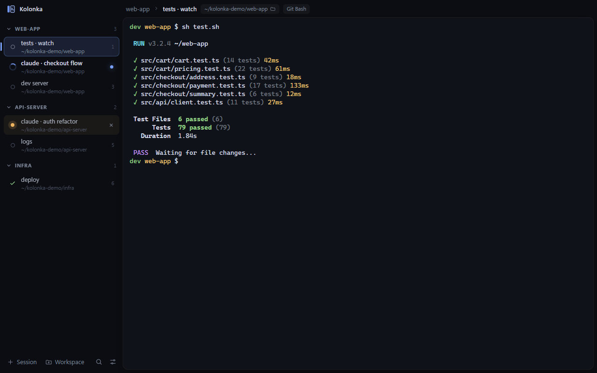

<div align="center">


# Kolonka

**A terminal for Windows with vertical tabs, workspaces, hold-to-talk voice input<br>and a full control API — made for running many shells and coding agents at once.**

[](https://github.com/huopolinen/kolonka/releases/latest)

[](https://github.com/huopolinen/kolonka/releases)
[](https://github.com/huopolinen/kolonka/releases)
[](LICENSE)




</div>

## Why I built it

Kolonka is directly inspired by [**agterm**](https://github.com/umputun/agterm) — and, more broadly, by the terminals on the Mac. On macOS you get tools that feel considered: fast, good-looking, organized around how you actually work, and scriptable all the way down. agterm in particular nailed the idea for the age of coding agents: a deliberately small interface, sessions in named workspaces, a status for each agent, and a complete control API on top.

But I don't get to live only on the Mac: my regular work happens there, while game development keeps me on Windows. Every time I switched machines I was honestly disappointed. The terminals on Windows either look and feel dated, or stop at a row of horizontal tabs that falls apart once you have five agents, two dev servers and a log tail running. None of them told me at a glance which agent was working and which one was waiting for me, and none of them could be driven by the agents themselves.

So I built the terminal I wanted on Windows. Kolonka keeps every shell in a **sidebar column**, grouped into **workspaces** — one per project — and shows which agent is **working**, which one **needs you**, and which one is **done**. Everything you can do with the mouse, a script or an agent can do too, through a local HTTP API and the bundled `kolonka` CLI. And because talking is often faster than typing a prompt, you can hold <kbd>Space</kbd> and just say it.

*Kolonka* (Russian *колонка*) means "column".

## Features

- **Vertical tabs, grouped in workspaces.** Collapse, rename, drag sessions between workspaces, reorder everything. Jump with `Ctrl+1…9`, `Ctrl+Tab`, or the command palette.
- **Agent status at a glance.** Each row shows `idle ○` · `working ◐` · `needs you ●` · `done ✓`. A collapsed workspace shows a badge. When an agent needs you while you are elsewhere, you get a Windows notification; clicking it jumps to the session.
- **Unread markers.** Background output (or a bell) puts a dot on the row until you look at it.
- **Hold Space to talk.** Hold <kbd>Space</kbd>, speak, release — the text is typed into the active tab. A short tap is still a normal space. Since it is plain terminal input, it works with anything: bash, PowerShell, Claude Code, vim, an `ssh` session on a remote server. Recognition runs **locally** with [whisper.cpp](https://github.com/ggml-org/whisper.cpp) (GPU via CUDA, or CPU); cloud engines are optional.
- **Control API + CLI.** Create sessions, type into them, read their screen back, wait for output, set status, send notifications. `kolonka` is on `PATH` inside every Kolonka tab automatically.
- **Claude Code hooks in one click.** Claude Code reports its own state onto its row.
- **Remote control over ssh.** A script on a server can open Kolonka tabs connected to that server, set its tab's status and send notifications — checked with a per-tab secret, with a permission prompt for anything not explicitly trusted.
- **Your shells.** Git Bash (default when installed), PowerShell 7, Windows PowerShell, cmd — or your own. The current directory is tracked, new tabs open where you are, and the whole layout comes back after a restart.
- **Pleasant to use.** Mica backdrop, WebGL rendering, command palette, search in scrollback, Ctrl+click links, Windows Terminal–style copy & paste, English UI (Russian available in settings).
- **Crash reports you control.** If something breaks, Kolonka offers a pre-filled GitHub issue with a scrubbed log — nothing is sent without you.

<table>
<tr>
<td width="50%"><br><sub><b>Command palette</b> (<code>Ctrl+Shift+P</code>): every session and command, fuzzy-searchable.</sub></td>
<td width="50%"><br><sub><b>Hold Space to talk</b>: the transcript lands in the active tab — local or over ssh.</sub></td>
</tr>
</table>

## Install

1. Download **`Kolonka-Setup-<version>.exe`** from the [latest release](https://github.com/huopolinen/kolonka/releases/latest).
2. Run it. It installs per user (no admin rights) into `%LOCALAPPDATA%\Programs\Kolonka` and adds Start menu and desktop shortcuts.

> The installer is not code-signed yet, so Windows SmartScreen may say *"Windows protected your PC"*. Click **More info → Run anyway**. If you prefer, build it yourself from source (below).

Requirements: Windows 10 1903+ or Windows 11, x64. [Git for Windows](https://git-scm.com/download/win) is recommended (Git Bash becomes the default shell).

### Checking the download

Releases after 0.1.0 are built by GitHub Actions from the tagged commit ([`release.yml`](.github/workflows/release.yml)), not on a developer's machine. Each release has a `SHA256SUMS.txt` and a signed build provenance attestation for the installer, so you can check that the file you have is the one CI built from this repository:

```powershell
# the checksum must match the line for the installer in SHA256SUMS.txt
Get-FileHash .\Kolonka-Setup-<version>.exe -Algorithm SHA256

# with the GitHub CLI: proves the file was built by this repository's release workflow
gh attestation verify .\Kolonka-Setup-<version>.exe -R huopolinen/kolonka
```

## Keyboard

| Keys | Action |
|---|---|
| <kbd>Ctrl</kbd>+<kbd>Shift</kbd>+<kbd>T</kbd> | New session in the current workspace |
| <kbd>Ctrl</kbd>+<kbd>Shift</kbd>+<kbd>N</kbd> | New workspace |
| <kbd>Ctrl</kbd>+<kbd>Shift</kbd>+<kbd>W</kbd> | Close session |
| <kbd>Ctrl</kbd>+<kbd>Shift</kbd>+<kbd>P</kbd> | Command palette |
| <kbd>F2</kbd> | Rename session |
| <kbd>Ctrl</kbd>+<kbd>Tab</kbd> · <kbd>Ctrl</kbd>+<kbd>PgDn</kbd>/<kbd>PgUp</kbd> | Next / previous session |
| <kbd>Ctrl</kbd>+<kbd>1</kbd> … <kbd>9</kbd> | Jump to session N |
| <kbd>Ctrl</kbd>+<kbd>Shift</kbd>+<kbd>PgDn</kbd>/<kbd>PgUp</kbd> | Move session down / up |
| <kbd>Ctrl</kbd>+<kbd>Shift</kbd>+<kbd>F</kbd> | Find in scrollback |
| <kbd>Ctrl</kbd>+<kbd>Shift</kbd>+<kbd>B</kbd> | Toggle sidebar |
| hold <kbd>Space</kbd> | Voice input |
| <kbd>Ctrl</kbd>+<kbd>C</kbd> (with a selection) · <kbd>Ctrl</kbd>+<kbd>Shift</kbd>+<kbd>C</kbd> | Copy |
| <kbd>Ctrl</kbd>+<kbd>V</kbd> · right click | Paste |
| <kbd>Ctrl</kbd>+<kbd>=</kbd> / <kbd>-</kbd> / <kbd>0</kbd> | Font size |

Middle-click a row to close it; right-click a row or a workspace for its menu; double-click to rename.

## Voice input

Hold <kbd>Space</kbd> in a terminal for ~0.3 s. A *Listening* pill appears; speak and release. The transcript is inserted as a paste (bracketed paste when the program supports it) — Enter is not pressed unless you enable `autoEnter`. Tapping Space types a space as usual, and pressing another key while Space is down just types normally.

On first use Kolonka offers to download whisper.cpp and the `large-v3-turbo` model into `%LOCALAPPDATA%\Kolonka\whisper` — about 1.3 GB with an NVIDIA GPU (CUDA), 0.6 GB CPU-only. Every file is pinned to a fixed whisper.cpp release and model revision and checked against its SHA-256 before use. After that it works offline. The local speech server listens on 127.0.0.1 under a random path known only to Kolonka. The model is unloaded after 10 idle minutes. On an RTX 4060 a sentence takes about 0.3 s.

Prefer the cloud? Set `"engine": "openai"` or `"groq"` and an `apiKey` (see [Configuration](#configuration)).

## Scripting

Every Kolonka tab has `kolonka` in its `PATH`. To use it from another terminal (Windows Terminal, an IDE, a scheduled task), call it by its full path or add its folder to your `PATH`: `%LOCALAPPDATA%\Programs\Kolonka\resources\bin\kolonka.cmd` (it uses Node.js if you have it, otherwise Kolonka's own runtime; Git Bash can run `resources/bin/kolonka` from the same folder).

Inside a Kolonka tab `kolonka` targets **its own** session by default (`$KOLONKA_SESSION`); elsewhere it targets the active one. A target can be an id (`s3`), a name, `workspace/name`, a 1-based position, or `current`.

```sh
ws=$(kolonka ws new demo)                                    # new workspace, prints its id
sid=$(kolonka new --ws "$ws" --name build --cwd . --no-select)
kolonka run -t "$sid" --wait 'passed|failed' --timeout 120000 npm test   # type + Enter, wait for its output
kolonka text -t "$sid" --lines 20                            # read the screen back
kolonka keys -t "$sid" ctrl+c                                # named keys: enter tab esc up f5 alt+x …
kolonka status done -t "$sid"                                # idle | active | blocked | done
kolonka notify "tests finished" -t "$sid"
kolonka tree --json                                          # the whole model
kolonka events                                               # live event stream (JSON lines)
```

A session created with a command (`kolonka new --name srv npm run dev`) remembers it: *Restart* runs it again. When Kolonka itself starts, restored sessions open as plain shells in their folders and their commands are not re-run — unless the tab was created with `--rerun` (or opened by a server, see [Remote control over SSH](#remote-control-over-ssh)), or `"restore": "rerun"` is set in settings.json, which re-runs the command of every tab that has one.

Options go before the command for `new`, `type` and `run`: from the first word of the command on, everything is passed as is, so `kolonka run grep -h x` runs `grep -h x`. To catch a misplaced option, `run` and `type` refuse a command that contains one of their own options (`-t`, `--enter`, `--wait`, `--timeout`, `--json`, `--skip-echo`); a command that really has one goes after `--`: `kolonka run -t "$sid" -- docker build . -t img`.

`wait` matches a regex against **new** output since the call (or the visible screen with `--screen`), waits for `--idle MS` of silence, or for `--exit`. Exit code 2 means timeout; `--timeout 0` waits without a limit.

Two things to know when you wait for the output of a command you have just typed:

- **Output can arrive before `wait` starts.** A fast command may print its result between `kolonka run` and `kolonka wait`. Use `run --wait RE` (one call), or take the position from `type`/`run`/`keys --json` (`{"seq": N}`) and pass it as `wait --since N`: output after that position is searched too.
- **The shell echoes what you type.** The command line itself shows up in the output, so `run "echo done"` + `wait --pattern done` matches the echo, not the result. `run --wait` skips that first echoed line for you (`wait --skip-echo` does the same); otherwise pick a pattern that is not part of the command, e.g. `--pattern '^done$'` or a marker the command prints, not types. Skipping relies on the echo ending with a line break; a program that redraws the line with cursor moves instead (a full-screen app, some prompts) may need such a pattern too.

`kolonka --help` lists every command.

### HTTP API

While Kolonka runs, `%APPDATA%\Kolonka\control.json` holds `{ url, port, token }` (default port 47811). Every request needs `Authorization: Bearer <token>`; requests from browsers (with an `Origin` header) are rejected.

| Method | Path | Body / query |
|---|---|---|
| GET | `/api/tree` | |
| GET | `/api/sessions` | `?workspace=` |
| POST | `/api/sessions` | `{workspace, name, cwd, shell, command, select, after, rerun}` |
| GET · PATCH · DELETE | `/api/sessions/:t` | PATCH `{name, status, workspace, index}` |
| POST | `/api/sessions/:t/select` · `/restart` | |
| POST | `/api/sessions/:t/type` | `{text, enter}` → `{seq}` |
| POST | `/api/sessions/:t/keys` | `{keys: ["ctrl+c", "enter"]}` → `{seq}` |
| GET | `/api/sessions/:t/text` | `?lines=N&all=1` |
| POST | `/api/sessions/:t/wait` | `{pattern, screen, idle, exit, since, skipEcho, timeout}`; `since`: a `seq` from type/keys (the last ~256 KB of output are kept); `timeout`: ms, default 30000, `0` = no limit; a wait ends when the client disconnects |
| GET | `/api/sessions/:t/stream` | SSE, raw output; ends when the session is closed |
| GET | `/api/events` | SSE: `session.created/updated/status/selected/closed/exited/bell/notify`, `workspace.*`, `remote.opened/denied` |
| GET · POST | `/api/workspaces` | POST `{name}` |
| GET · PATCH · DELETE | `/api/workspaces/:w` | GET: one workspace with its sessions, as in `/api/tree`; PATCH `{name, collapsed, index}`; DELETE `?force=1` |
| POST | `/api/notify` | `{text, title, session}` |
| GET | `/api/remote` | remote control: `{enabled, allowHosts, remembered}` |
| DELETE | `/api/remote/hosts/:host` | forget a host allowed with *Always for this host* |
| POST | `/api/screenshot` | `{path}` |
| GET · POST | `/api/window` | POST `{action: "focus" \| "toggle-sidebar" \| "quit"}` |

```sh
curl -H "Authorization: Bearer $TOKEN" http://127.0.0.1:47811/api/tree
```

### Claude Code status hooks

⚙ → **Claude Code hooks: install** (or `kolonka hooks install`) adds four hooks to `~/.claude/settings.json`, keeping a backup of the original next to it (`settings.json.kolonka-backup`, written once):

| Hook | Status |
|---|---|
| `UserPromptSubmit`, `PostToolUse` | working |
| `Notification` (permission prompt, idle) | needs you |
| `Stop` | done |

The hooks call Kolonka's launcher, so they work without Node.js in `PATH`. Outside Kolonka, or once Kolonka is removed, they exit silently. `kolonka hooks uninstall` removes exactly these entries (including the `node "…kolonka.js"` form older versions wrote), and so does uninstalling Kolonka from Windows settings; the uninstaller also offers to delete the downloaded voice files.

For Claude Code running **on a server** in an ssh tab, see [Remote control over SSH](#claude-code-on-a-server).

## Remote control over SSH

A program on a server you are connected to over ssh can ask Kolonka to **open a new tab connected to the same server**, to set the **status** of its tab, to show a **notification** or to **rename** the tab. It does so by printing an escape sequence to its terminal; Kolonka sees it in the output of the tab and acts on it. Nothing listens on the network and nothing has to run on your computer besides Kolonka.

```sh
# on the server, in a Kolonka ssh tab
kolonka open --name logs -- journalctl -fu myapp     # a new Kolonka tab: ssh to this server, running the command
kolonka open --here                                  # a shell on this server, in the current directory
kolonka status blocked                               # this tab: needs you
kolonka notify "deploy finished" --title myserver    # a notification; clicking it switches to this tab
kolonka rename "build box"
```

### Setting it up

1. **Install the script on the server**: `kolonka remote install myserver` (from a Kolonka tab on Windows) copies [`bin/kolonka-remote`](bin/kolonka-remote) to `~/.local/bin/kolonka` over ssh, asking before it overwrites a file there. It is a POSIX `sh` script that needs only `printf`, `sed` and `base64`; you can also copy it by hand.
2. **Send Kolonka's variables over ssh.** Every Kolonka tab has `LC_TERMINAL=Kolonka`, `LC_TERMINAL_VERSION=<version>` and `LC_KOLONKA_TOKEN=<a random secret of this tab>` in its environment. The script does nothing (exit code 3) when `LC_TERMINAL` is not `Kolonka`, so it never prints junk into other terminals, and it sends the token along with every request (see [who may open tabs](#who-may-open-tabs)). The OpenSSH client of Windows does not send `LC_*` variables on its own; add to `%USERPROFILE%\.ssh\config`:
   ```
   Host *
     SendEnv LC_TERMINAL LC_TERMINAL_VERSION LC_KOLONKA_TOKEN
   ```
   The server's sshd must accept them: Debian and Ubuntu do by default (`AcceptEnv LANG LC_*` in `/etc/ssh/sshd_config`); elsewhere add `AcceptEnv LC_TERMINAL LC_TERMINAL_VERSION LC_KOLONKA_TOKEN`. Tabs Kolonka opens itself always send them (`-o SendEnv=…`).
3. **tmux** (3.3 or newer) drops escape sequences it does not know unless passthrough is on. In `~/.tmux.conf` on the server:
   ```
   set -g allow-passthrough on
   set -ga update-environment " LC_KOLONKA_TOKEN LC_TERMINAL LC_TERMINAL_VERSION"
   ```
   The script wraps its sequences for tmux by itself when `$TMUX` is set, and takes `LC_TERMINAL` and the token of the client attached last (`tmux show-environment`), so a tmux session started from another terminal works once you attach to it from Kolonka. If two Kolonka tabs are attached to one tmux session, requests carry the token of the one attached last; the other tab asks. GNU screen is not supported.

### Opening tabs

`kolonka open` asks for a tab connected to **the same server** (`--same`, the default) or to another host (`--host H`, a name from your `~/.ssh/config`, `user@host` or an address). One argument after `--` is a shell command line (`kolonka open -- 'tail -f app.log | grep ERROR'`); several are a command and its arguments, each quoted for the remote shell. With no command you get a login shell. `--name`, `--ws` (a workspace by name, created if needed) and `--no-select` work as for `kolonka new`; `--no-rerun` asks Kolonka not to reconnect the tab when it starts.

Kolonka builds the command itself — `ssh.exe -t -o SendEnv=LC_TERMINAL -o SendEnv=LC_TERMINAL_VERSION -o SendEnv=LC_KOLONKA_TOKEN [options] -- <host> <command>` — and starts ssh.exe directly, without a shell, with every argument in double quotes, quoted for the parser of that ssh.exe (the C runtime for the OpenSSH client of Windows, the msys runtime for the one of Git for Windows, which would otherwise expand `@file`, `~`, `*` and `{a,b}` in unquoted arguments). The command is one argument that only the shell on the server interprets.

"The same server" is found this way: for a tab Kolonka opened over ssh, it is the connection Kolonka made. For a tab where you typed `ssh …` yourself (in Git Bash, PowerShell or cmd), Kolonka looks for the `ssh.exe` running under the tab's shell (through the Windows process list) and takes its destination and these options: `-p -l -i -J -4 -6`; `-v -t -T -q -C -A` are left out (a new tab never gets your agent). A connection that needs anything else (`-o`, `-F`, forwardings…) is **refused** rather than made without it — "can't reproduce this ssh connection": put such settings into `~/.ssh/config` for that host. If the tab is in a nested ssh (ssh from the server to another one), "same" still means the server the tab connected to.

ssh.exe is the one the asking tab runs, if it is the OpenSSH client of Windows (`%SystemRoot%\System32\OpenSSH\ssh.exe`), the one of an installed Git for Windows (`…\Git\usr\bin\ssh.exe`) or `remote.ssh`; otherwise `remote.ssh`, then the Windows one, then Git's. Note that a new tab does not see the ssh-agent of a Git Bash session (`SSH_AUTH_SOCK`): use the *OpenSSH Authentication Agent* service of Windows, or keys without a passphrase prompt, or set `remote.ssh`.

### Who may open tabs

Terminal output is not trusted: any program on the server — or `cat` of a file, `tail -f` of a log with escape sequences in it, `git log` of someone's repository, the `remote:` lines of a git server — can print these sequences. So:

- **Only ssh tabs may ask.** A request from a tab that is not an ssh session right now (no ssh.exe under it, not opened by Kolonka over ssh) is refused, so `cat` of a downloaded file in a local shell cannot open anything. (`"fromLocalTabs": true` lets local tabs ask for a named host — with the same checks below.)
- **Without the tab's token, you are asked — every time.** Kolonka gives each run of each tab a new random `LC_KOLONKA_TOKEN` and accepts a request as coming *from your session* only if it carries that token (compared in constant time). Text a program merely displays does not know it. Only such a request to a host in `remote.allowHosts` (or allowed with *Always for this host*) opens without a question. Any other request shows the dialog: *The tab "build" (s3), connected to myserver, wants to open a tab there running: …* — **Allow once**, **Always for this host** (only with a valid token; remembered in `state.json`; `kolonka remote hosts` lists them, `kolonka remote forget HOST` drops one), **Deny** (no more requests from that tab for 10 minutes) or **Deny for this tab**. Requests that waited behind the dialog are asked about one by one, also after an *Always*.
- **Hosts are compared as a whole**: `user@host:port`, with the user and port from `-l` / `-p` too. `"prod"` in `allowHosts` allows `ssh prod`, not `ssh root@prod` or `ssh -p 2222 prod`. For `--host` the question is about the other host, which matters: connecting to a host offers it your keys (and your agent, if you forward it).
- **What you see is what runs.** A command longer than 512 characters, on several lines, or with control or invisible characters (bidi marks, zero-width and tag characters, separators, fillers) is refused rather than shown cleaned up; runs of spaces are collapsed in the dialog. A tab name the server set is not used to describe the tab in the dialog. Names and notification texts are cut to 80 / 300 characters with such characters removed.
- **No ssh options from the server.** The server names a host (checked against `^[A-Za-z0-9._@:-]+$`, never starting with `-` or `@`) and a command, never ssh options or an ssh command line, so it cannot use `ProxyCommand`, `LocalCommand` or `-F` to run something on your computer.
- **Reconnecting at startup is for trusted tabs.** A tab opened by a request with the token to an allowed host reconnects when Kolonka starts (unless the server sent `rerun=0`); a tab you allowed once shows *not connected — Enter: connect*. The saved path of its ssh.exe is checked against the list above again.
- **Limits.** 10 open requests, 10 notifications and 10 status changes a minute per tab (tabs opened by a server count towards the tab that opened them), 20 open requests a minute in all, at most `remote.maxTabs` (30) running tabs opened by servers; the rest are dropped and noted in `logs\main.log`.
- **Off switch.** `"remote": { "enabled": false }` ignores all of it.

What the token does **not** protect against: anything that runs as you (or as root) on the server can read the token from the environment of your session and use it, and so can a host you forward it to with `SendEnv` in a nested ssh. It protects against text — logs, files, output of programs that do not have your session's environment — not against a compromised account. For hosts you do not fully trust, leave them out of `allowHosts`: every request then shows the dialog.

Status and rename requests need no permission: they only change how the tab looks.

### Notifications from other tools

Besides `kolonka notify`, Kolonka shows the notifications other terminals understand: `OSC 9 ; <text>` (iTerm2, Windows Terminal — not ConEmu's `9;N;…` commands) and `OSC 777 ; notify ; <title> ; <body>` (urxvt, Ghostty). They work in local tabs too.

### Claude Code on a server

`kolonka hooks print --remote` prints hooks for `~/.claude/settings.json` **on the server**: the same four events as the local hooks, calling `~/.local/bin/kolonka status …`. They are silent, print nothing on stdout (Claude Code would add it to the prompt) and exit 0 when the script is missing or the terminal is not Kolonka.

The script writes to `/dev/tty`, which a hook has as long as Claude Code itself runs in a terminal and starts hooks in its own session (it does as of this writing). If the status does not change in your setup, Claude Code's own terminal notifications are a fallback: `claude config set --global preferredNotifChannel iterm2` makes it print `OSC 9` notifications, which Kolonka shows (you get notifications, not the status glyph).

### The escape sequences

For script authors: `ESC ] 7711 ; <action> ; key=value ; … BEL` (or `ESC \` instead of `BEL`). Values are standard base64 of UTF-8 (padding optional) except `select`, `rerun` and `state`; unknown keys are ignored. Every action takes `token=` (base64 of `$LC_KOLONKA_TOKEN`); without it `open` always asks.

| Action | Fields |
|---|---|
| `open` | `host=` (required; `@same` or a host), `cmd=`, `name=`, `ws=`, `select=0\|1` (default 1), `rerun=0\|1` (default 1; only for trusted requests), `token=` |
| `status` | `state=idle\|active\|blocked\|done` (`blocked` = needs you) |
| `notify` | `title=`, `text=` |
| `rename` | `name=` |

```sh
b64() { printf '%s' "$1" | base64 | tr -d '\n'; }
printf '\033]7711;open;host=%s;cmd=%s;name=%s;token=%s\007' "$(b64 @same)" "$(b64 'htop')" "$(b64 top)" "$(b64 "$LC_KOLONKA_TOKEN")" > /dev/tty
# inside tmux, wrapped:
printf '\033Ptmux;\033\033]7711;status;state=blocked\007\033\\' > /dev/tty
```

## Configuration

`%APPDATA%\Kolonka\settings.json` (⚙ → *Open settings.json*; restart to apply). Put only the options you want to change there — everything else keeps its default, and new defaults reach you with updates. Comments (`//`, `/* */`) and trailing commas are allowed. If the file cannot be read, Kolonka says so in the window (and in `logs\main.log`) and runs with the defaults; the file itself is left untouched. Font size changed with <kbd>Ctrl</kbd>+<kbd>=</kbd>/<kbd>-</kbd> and a dragged sidebar width are remembered until you set `fontSize` / `sidebarWidth` here. Kolonka 0.1.0 wrote a copy of all its defaults into this file; an untouched copy like that is replaced once by the short template (the old file is kept as `settings.json.bak-0.1.0`), an edited one is left as it is.

```jsonc
{
  "language": "en",                       // en | ru | auto (follow Windows)
  "defaultShell": "bash",                 // bash | pwsh | powershell | cmd | your own key
  "fontFamily": "'Cascadia Mono', Consolas, monospace",
  "fontSize": 14,
  "apiPort": 47811,                       // falls back to a random port if busy
  "notifications": true,
  "backgroundMaterial": "mica",           // mica | acrylic | tabbed | none
  "restore": "fresh",                     // fresh | rerun: re-run the command of every tab at startup
  "remote": {                             // remote control over ssh
    "enabled": true,
    "allowHosts": ["leo@myserver"],       // user@host[:port] that may open tabs without asking (with the tab token)
    "ssh": "",                            // path to ssh.exe; empty = Windows OpenSSH, then Git for Windows
    "fromLocalTabs": false,
    "maxTabs": 30                         // running tabs opened by servers
  },
  "shells": {                             // optional extra shells
    "nu": { "label": "Nushell", "file": "C:/Program Files/nu/bin/nu.exe", "args": [], "env": {} }
  },
  "dictation": {
    "enabled": true,
    "key": "Space",                       // any KeyboardEvent.code, e.g. "ControlRight"
    "holdMs": 300,
    "engine": "local",                    // local | openai | groq
    "language": "auto",                   // auto | en | ru | de …
    "device": "",                         // part of a microphone name; empty = Windows default
    "autoEnter": false,
    "prompt": "Claude Code, git, npm, SSH …",   // vocabulary hint for the recognizer
    "local": { "build": "auto", "model": "large-v3-turbo-q5_0", "idleMinutes": 10 },
    "openai": { "apiKey": "", "model": "gpt-4o-mini-transcribe" },
    "groq": { "apiKey": "", "model": "whisper-large-v3-turbo" }
  }
}
```

State, window position, logs and `control.json` live in the same folder. `KOLONKA_DATA` overrides it — handy for a second, isolated instance. If that folder is outside your user profile, Kolonka limits `control.json` (it holds the API token) to your account.

## Crash reports and privacy

Kolonka has no telemetry. If the app hits an unexpected error, a window crashes, or the previous run ended in a crash, it offers to **open a pre-filled GitHub issue** with version info and the last lines of its log. Your home folder, user name, computer name and tokens are scrubbed, and you see the issue in your browser before anything is submitted. Logs and crash dumps stay in `%APPDATA%\Kolonka\logs` and `%APPDATA%\Kolonka\Crashpad`; attach them yourself if you like. You can also use ⚙ → **Report a problem…** at any time. If the installer fails, it offers the same.

## Build from source

```sh
git clone https://github.com/huopolinen/kolonka && cd kolonka
npm install          # npm ≥ 11 may ask you to approve the install script of node-pty
npm start            # run from source (the first run downloads Electron)
npm run dist         # build dist/Kolonka-Setup-<version>.exe
```

Tests use Node's built-in runner, no extra dependencies:

```sh
npm test             # unit tests (test/*.test.js)
npm run pack         # build dist/win-unpacked
npm run smoke        # start the packaged app, drive it through the CLI and quit it (Windows)
```

CI runs all three on every pull request.

Stack: [Electron](https://www.electronjs.org/), [xterm.js](https://xtermjs.org/) (WebGL renderer, headless mirror for the API), [node-pty](https://github.com/microsoft/node-pty) on ConPTY, [whisper.cpp](https://github.com/ggml-org/whisper.cpp) for voice input.

## Roadmap

Split panes and overlays · themes · Windows' built-in speech engine as a dictation option · auto-update · code signing.

## Acknowledgements

Huge thanks to [agterm](https://github.com/umputun/agterm) by Umputun — the macOS terminal that inspired Kolonka's model of workspaces, agent status and a complete control surface — and to the Mac terminal scene in general for showing how good a terminal can feel. Kolonka is an independent implementation for Windows and shares no code with agterm.

## License

[MIT](LICENSE). Kolonka bundles xterm.js and node-pty (MIT) and Electron (MIT, with Chromium's licenses). whisper.cpp (MIT) and the Whisper model (MIT) are downloaded on demand.
