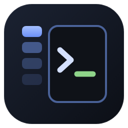
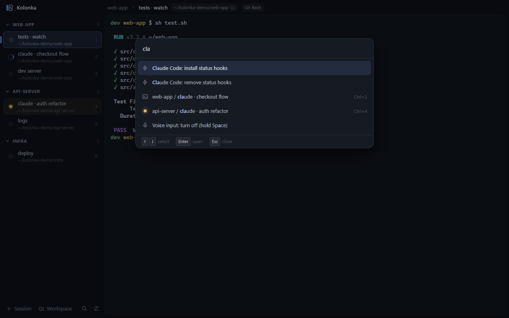
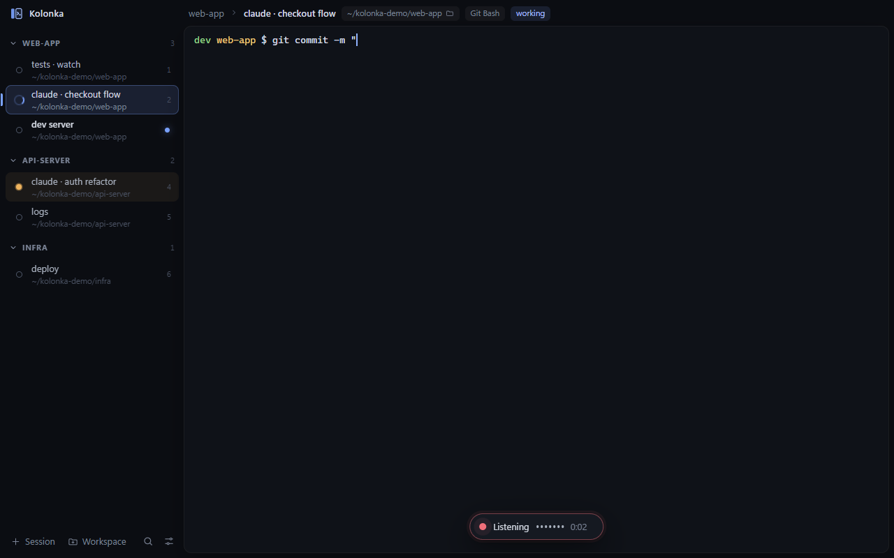

<div align="center">



# Kolonka

**A terminal for Windows with vertical tabs, workspaces, hold-to-talk voice input<br>and a full control API — made for running many shells and coding agents at once.**

[](https://github.com/huopolinen/kolonka/releases/latest)

[](https://github.com/huopolinen/kolonka/releases)
[](https://github.com/huopolinen/kolonka/releases)
[](LICENSE)


</div>

## Why I built it

Kolonka is directly inspired by [**agterm**](https://github.com/umputun/agterm) — and, more broadly, by the terminals on the Mac. On macOS you get tools that feel considered: fast, good-looking, organized around how you actually work, and scriptable all the way down. agterm in particular nailed the idea for the age of coding agents: a deliberately small interface, sessions in named workspaces, a status for each agent, and a complete control API on top.

But I don't get to live only on the Mac: my regular work happens there, while game development keeps me on Windows. Every time I switched machines I was honestly disappointed. The terminals on Windows either look and feel dated, or stop at a row of horizontal tabs that falls apart once you have five agents, two dev servers and a log tail running. None of them told me at a glance which agent was working and which one was waiting for me, and none of them could be driven by the agents themselves.

So I built the terminal I wanted on Windows. Kolonka keeps every shell in a **sidebar column**, grouped into **workspaces** — one per project — and shows which agent is **working**, which one **needs you**, and which one is **done**. Everything you can do with the mouse, a script or an agent can do too, through a local HTTP API and the bundled `kolonka` CLI. And because talking is often faster than typing a prompt, you can hold <kbd>Space</kbd> and just say it.

*Kolonka* (Russian *колонка*) means "column".

## Features

- **Vertical tabs, grouped in workspaces.** Collapse, rename, drag sessions between workspaces, reorder everything. Jump with `Ctrl+1…9`, `Ctrl+Tab`, or the command palette.
- **Agent status at a glance.** Each row shows `idle ○` · `working ◐` · `needs you ●` · `done ✓`. A collapsed workspace shows a badge. When an agent needs you while you are elsewhere, you get a Windows notification; clicking it jumps to the session.
- **Unread markers.** Background output (or a bell) puts a dot on the row until you look at it.
- **Hold Space to talk.** Hold <kbd>Space</kbd>, speak, release — the text is typed into the active tab. A short tap is still a normal space. Since it is plain terminal input, it works with anything: bash, PowerShell, Claude Code, vim, an `ssh` session on a remote server. Recognition runs **locally** with [whisper.cpp](https://github.com/ggml-org/whisper.cpp) (GPU via CUDA, or CPU); cloud engines are optional.
- **Control API + CLI.** Create sessions, type into them, read their screen back, wait for output, set status, send notifications. `kolonka` is on `PATH` inside every Kolonka tab automatically.
- **Claude Code hooks in one click.** Claude Code reports its own state onto its row.
- **Your shells.** Git Bash (default when installed), PowerShell 7, Windows PowerShell, cmd — or your own. The current directory is tracked, new tabs open where you are, and the whole layout comes back after a restart.
- **Pleasant to use.** Mica backdrop, WebGL rendering, command palette, search in scrollback, Ctrl+click links, Windows Terminal–style copy & paste, English UI (Russian available in settings).
- **Crash reports you control.** If something breaks, Kolonka offers a pre-filled GitHub issue with a scrubbed log — nothing is sent without you.

<table>
<tr>
<td width="50%"><br><sub><b>Command palette</b> (<code>Ctrl+Shift+P</code>): every session and command, fuzzy-searchable.</sub></td>
<td width="50%"><br><sub><b>Hold Space to talk</b>: the transcript lands in the active tab — local or over ssh.</sub></td>
</tr>
</table>

## Install

1. Download **`Kolonka-Setup-<version>.exe`** from the [latest release](https://github.com/huopolinen/kolonka/releases/latest).
2. Run it. It installs per user (no admin rights) into `%LOCALAPPDATA%\Programs\Kolonka` and adds Start menu and desktop shortcuts.

> The installer is not code-signed yet, so Windows SmartScreen may say *"Windows protected your PC"*. Click **More info → Run anyway**. If you prefer, build it yourself from source (below).

Requirements: Windows 10 1903+ or Windows 11, x64. [Git for Windows](https://git-scm.com/download/win) is recommended (Git Bash becomes the default shell).

## Keyboard

| Keys | Action |
|---|---|
| <kbd>Ctrl</kbd>+<kbd>Shift</kbd>+<kbd>T</kbd> | New session in the current workspace |
| <kbd>Ctrl</kbd>+<kbd>Shift</kbd>+<kbd>N</kbd> | New workspace |
| <kbd>Ctrl</kbd>+<kbd>Shift</kbd>+<kbd>W</kbd> | Close session |
| <kbd>Ctrl</kbd>+<kbd>Shift</kbd>+<kbd>P</kbd> | Command palette |
| <kbd>F2</kbd> | Rename session |
| <kbd>Ctrl</kbd>+<kbd>Tab</kbd> · <kbd>Ctrl</kbd>+<kbd>PgDn</kbd>/<kbd>PgUp</kbd> | Next / previous session |
| <kbd>Ctrl</kbd>+<kbd>1</kbd> … <kbd>9</kbd> | Jump to session N |
| <kbd>Ctrl</kbd>+<kbd>Shift</kbd>+<kbd>PgDn</kbd>/<kbd>PgUp</kbd> | Move session down / up |
| <kbd>Ctrl</kbd>+<kbd>Shift</kbd>+<kbd>F</kbd> | Find in scrollback |
| <kbd>Ctrl</kbd>+<kbd>Shift</kbd>+<kbd>B</kbd> | Toggle sidebar |
| hold <kbd>Space</kbd> | Voice input |
| <kbd>Ctrl</kbd>+<kbd>C</kbd> (with a selection) · <kbd>Ctrl</kbd>+<kbd>Shift</kbd>+<kbd>C</kbd> | Copy |
| <kbd>Ctrl</kbd>+<kbd>V</kbd> · right click | Paste |
| <kbd>Ctrl</kbd>+<kbd>=</kbd> / <kbd>-</kbd> / <kbd>0</kbd> | Font size |

Middle-click a row to close it; right-click a row or a workspace for its menu; double-click to rename.

## Voice input

Hold <kbd>Space</kbd> in a terminal for ~0.3 s. A *Listening* pill appears; speak and release. The transcript is inserted as a paste (bracketed paste when the program supports it) — Enter is not pressed unless you enable `autoEnter`. Tapping Space types a space as usual, and pressing another key while Space is down just types normally.

On first use Kolonka offers to download whisper.cpp and the `large-v3-turbo` model into `%LOCALAPPDATA%\Kolonka\whisper` — about 1.3 GB with an NVIDIA GPU (CUDA), 0.6 GB CPU-only. After that it works offline. The model is unloaded after 10 idle minutes. On an RTX 4060 a sentence takes about 0.3 s.

Prefer the cloud? Set `"engine": "openai"` or `"groq"` and an `apiKey` (see [Configuration](#configuration)).

## Scripting

Inside a Kolonka tab `kolonka` targets **its own** session by default (`$KOLONKA_SESSION`); elsewhere it targets the active one. A target can be an id (`s3`), a name, `workspace/name`, a 1-based position, or `current`.

```sh
ws=$(kolonka ws new demo)                                    # new workspace, prints its id
sid=$(kolonka new --ws "$ws" --name build --cwd . --no-select)
kolonka run -t "$sid" "npm test"                             # type + Enter
kolonka wait -t "$sid" --pattern 'passed|failed' --timeout 120000
kolonka text -t "$sid" --lines 20                            # read the screen back
kolonka keys -t "$sid" ctrl+c                                # named keys: enter tab esc up f5 alt+x …
kolonka status done -t "$sid"                                # idle | active | blocked | done
kolonka notify "tests finished" -t "$sid"
kolonka tree --json                                          # the whole model
kolonka events                                               # live event stream (JSON lines)
```

`wait` matches a regex against **new** output since the call (or the visible screen with `--screen`), waits for `--idle MS` of silence, or for `--exit`. Exit code 2 means timeout. `kolonka --help` lists every command.

### HTTP API

While Kolonka runs, `%APPDATA%\Kolonka\control.json` holds `{ url, port, token }` (default port 47811). Every request needs `Authorization: Bearer <token>`; requests from browsers (with an `Origin` header) are rejected.

| Method | Path | Body / query |
|---|---|---|
| GET | `/api/tree` | |
| GET | `/api/sessions` | `?workspace=` |
| POST | `/api/sessions` | `{workspace, name, cwd, shell, command, select, after}` |
| GET · PATCH · DELETE | `/api/sessions/:t` | PATCH `{name, status, workspace, index}` |
| POST | `/api/sessions/:t/select` · `/restart` | |
| POST | `/api/sessions/:t/type` | `{text, enter}` |
| POST | `/api/sessions/:t/keys` | `{keys: ["ctrl+c", "enter"]}` |
| GET | `/api/sessions/:t/text` | `?lines=N&all=1` |
| POST | `/api/sessions/:t/wait` | `{pattern, screen, idle, exit, timeout}` |
| GET | `/api/sessions/:t/stream` | SSE, raw output |
| GET | `/api/events` | SSE: `session.created/updated/status/selected/closed/exited/bell`, `workspace.*` |
| GET · POST · PATCH · DELETE | `/api/workspaces[/:w]` | `{name, collapsed, index}`, DELETE `?force=1` |
| POST | `/api/notify` | `{text, title, session}` |
| POST | `/api/screenshot` | `{path}` |
| GET · POST | `/api/window` | POST `{action: "focus" \| "toggle-sidebar" \| "quit"}` |

```sh
curl -H "Authorization: Bearer $TOKEN" http://127.0.0.1:47811/api/tree
```

### Claude Code status hooks

⚙ → **Claude Code hooks: install** (or `kolonka hooks install`) adds four hooks to `~/.claude/settings.json`, keeping a backup next to it:

| Hook | Status |
|---|---|
| `UserPromptSubmit`, `PostToolUse` | working |
| `Notification` (permission prompt, idle) | needs you |
| `Stop` | done |

Outside Kolonka the hook exits silently. `kolonka hooks uninstall` removes exactly these entries.

## Configuration

`%APPDATA%\Kolonka\settings.json` (⚙ → *Open settings.json*; restart to apply):

```jsonc
{
  "language": "en",                       // en | ru | auto (follow Windows)
  "defaultShell": "bash",                 // bash | pwsh | powershell | cmd | your own key
  "fontFamily": "'Cascadia Mono', Consolas, monospace",
  "fontSize": 14,
  "apiPort": 47811,                       // falls back to a random port if busy
  "notifications": true,
  "backgroundMaterial": "mica",           // mica | acrylic | tabbed | none
  "shells": {                             // optional extra shells
    "nu": { "label": "Nushell", "file": "C:/Program Files/nu/bin/nu.exe", "args": [], "env": {} }
  },
  "dictation": {
    "enabled": true,
    "key": "Space",                       // any KeyboardEvent.code, e.g. "ControlRight"
    "holdMs": 300,
    "engine": "local",                    // local | openai | groq
    "language": "auto",                   // auto | en | ru | de …
    "device": "",                         // part of a microphone name; empty = Windows default
    "autoEnter": false,
    "prompt": "Claude Code, git, npm, SSH …",   // vocabulary hint for the recognizer
    "local": { "build": "auto", "model": "large-v3-turbo-q5_0", "idleMinutes": 10 },
    "openai": { "apiKey": "", "model": "gpt-4o-mini-transcribe" },
    "groq": { "apiKey": "", "model": "whisper-large-v3-turbo" }
  }
}
```

State, window position, logs and `control.json` live in the same folder. `KOLONKA_DATA` overrides it — handy for a second, isolated instance.

## Crash reports and privacy

Kolonka has no telemetry. If the app hits an unexpected error, a window crashes, or the previous run ended in a crash, it offers to **open a pre-filled GitHub issue** with version info and the last lines of its log. Your home folder, user name, computer name and tokens are scrubbed, and you see the issue in your browser before anything is submitted. Logs and crash dumps stay in `%APPDATA%\Kolonka\logs` and `%APPDATA%\Kolonka\Crashpad`; attach them yourself if you like. You can also use ⚙ → **Report a problem…** at any time. If the installer fails, it offers the same.

## Build from source

```sh
git clone https://github.com/huopolinen/kolonka && cd kolonka
npm install          # npm ≥ 11 may ask you to approve install scripts for electron and node-pty
npm start            # run from source
npm run dist         # build dist/Kolonka-Setup-<version>.exe
```

Stack: [Electron](https://www.electronjs.org/), [xterm.js](https://xtermjs.org/) (WebGL renderer, headless mirror for the API), [node-pty](https://github.com/microsoft/node-pty) on ConPTY, [whisper.cpp](https://github.com/ggml-org/whisper.cpp) for voice input.

## Roadmap

Split panes and overlays · themes · Windows' built-in speech engine as a dictation option · auto-update · code signing.

## Acknowledgements

Huge thanks to [agterm](https://github.com/umputun/agterm) by Umputun — the macOS terminal that inspired Kolonka's model of workspaces, agent status and a complete control surface — and to the Mac terminal scene in general for showing how good a terminal can feel. Kolonka is an independent implementation for Windows and shares no code with agterm.

## License

[MIT](LICENSE). Kolonka bundles xterm.js and node-pty (MIT) and Electron (MIT, with Chromium's licenses). whisper.cpp (MIT) and the Whisper model (MIT) are downloaded on demand.
